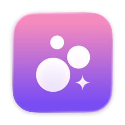
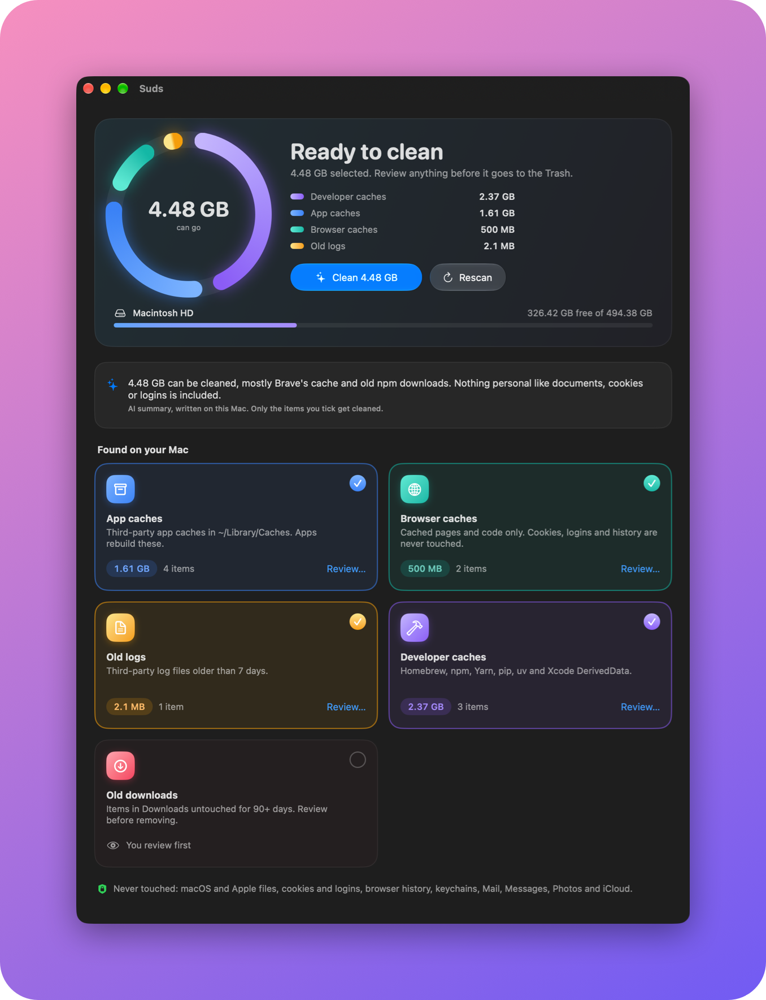
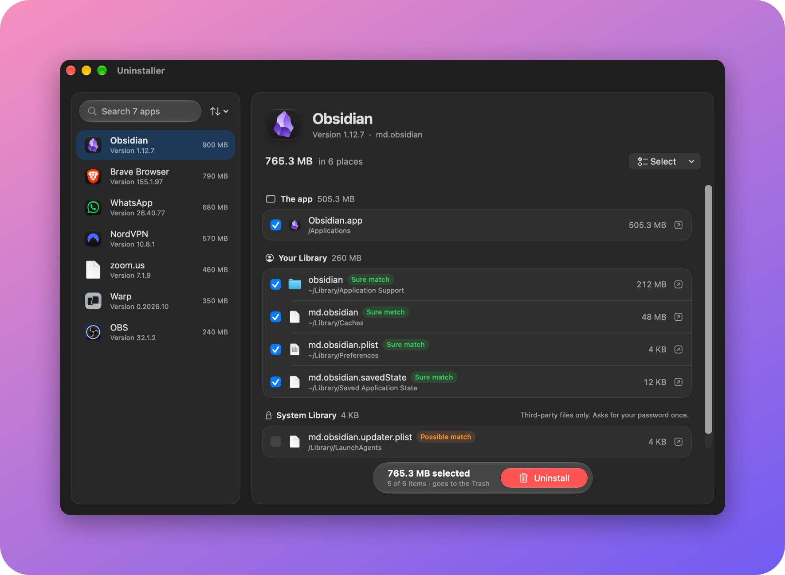
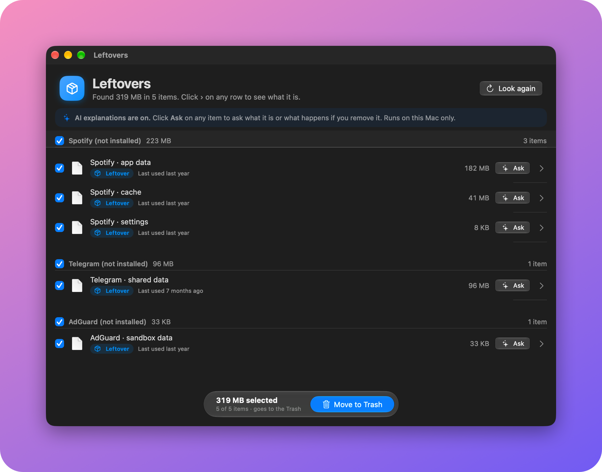
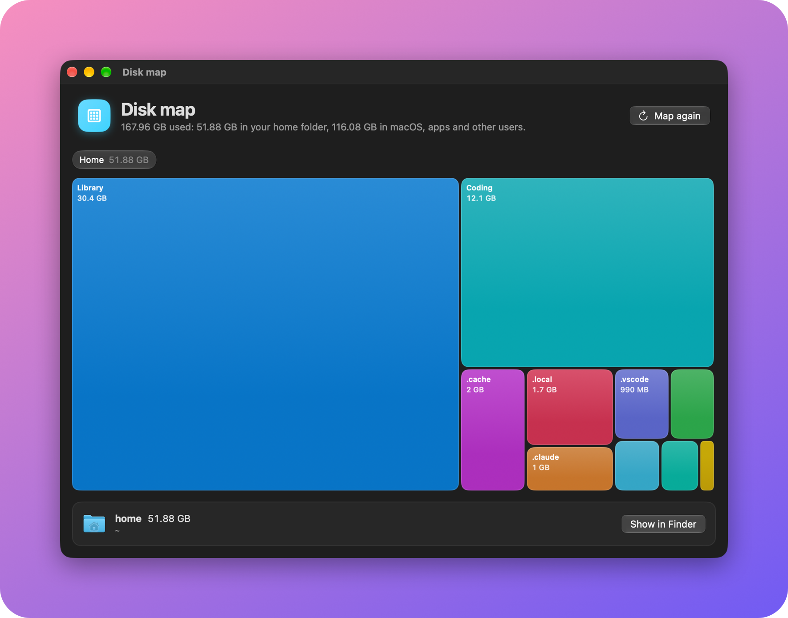
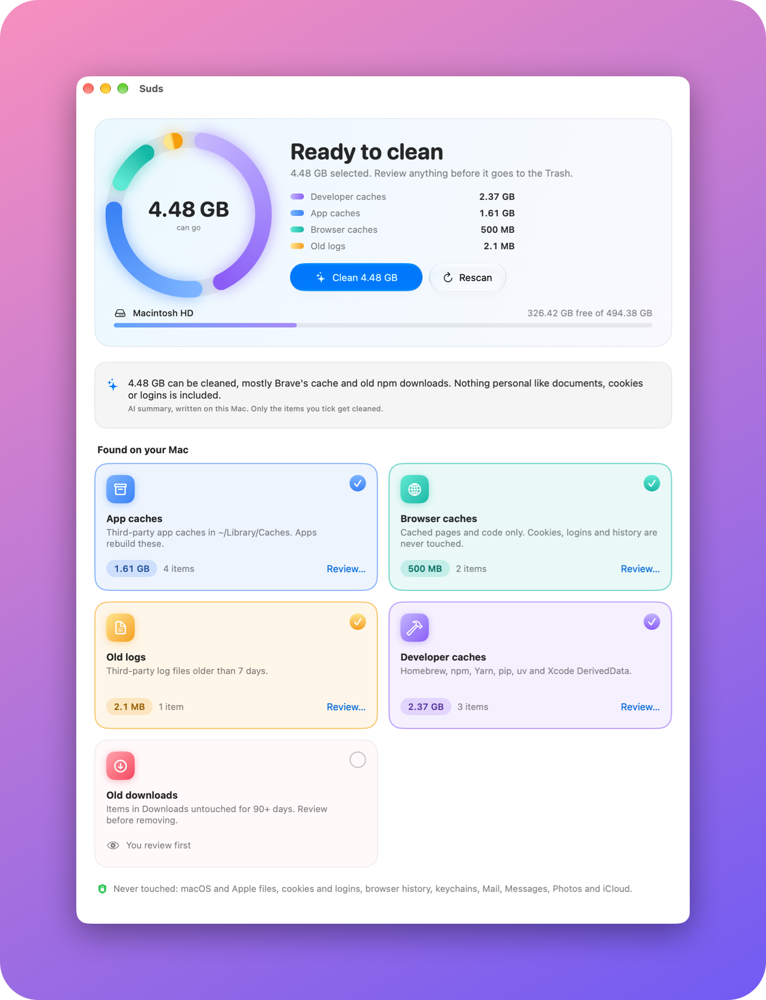

<p align="center">
  
</p>

<h1 align="center">Suds</h1>

<p align="center">
  A macOS storage cleaner and complete app uninstaller that explains every file before it touches anything.
</p>

<p align="center">
  <a href="https://github.com/glenlouis8/suds-mac/releases/latest"><b>Download</b></a> ·
  <a href="#why-you-can-trust-it">Why you can trust it</a> ·
  <a href="#build-and-run">Build it yourself</a>
</p>

<p align="center">
  <picture>
    <source media="(prefers-color-scheme: light)" srcset="docs/images/cleaner-light.png">
    
  </picture>
</p>

Built for macOS 26 (Tahoe) and later with SwiftUI and Liquid Glass. Free and open source, with no subscriptions, accounts, upsells or tracking. (It used to be called CompClean.)

## Why I built this

I got tired of Mac cleaner apps. Most want a subscription, flash a scary number of gigabytes at you, and then delete things without really telling you what they were. I didn't want to hand that kind of access to my Mac to an app I couldn't see inside.

So I built my own, with a few rules. It never touches macOS. It never signs me out of anything. It explains every single item in plain words before anything moves. And nothing is ever really deleted, because everything goes to the Trash and can be put back.

The first clean on my own Mac moved 3.4 GB of caches to the Trash. The leftovers finder turned up files from 21 apps I'd deleted long ago. Testing it against my own Mac also caught its own mistakes before they shipped: two macOS parts it would have flagged, and updater frameworks that apps I still use depend on. Those are now blocked by rules and covered by tests.

It's free, and it stays free. If it helps you, great. If you spot something it gets wrong, please [open an issue](https://github.com/glenlouis8/suds-mac/issues).

## Download

**[Download the latest Suds.dmg](https://github.com/glenlouis8/suds-mac/releases/latest)** (macOS 26+, Apple silicon)

1. Open the `.dmg` and drag **Suds** into **Applications**.
2. Open Suds. macOS will say it *"could not verify Suds is free of malware"*. This happens because the app isn't signed with a paid Apple Developer account, not because anything was found.
3. Go to **System Settings → Privacy & Security**, scroll down, and click **Open Anyway** next to Suds. You only have to do this once.
4. Give it **Full Disk Access** when it asks (System Settings → Privacy & Security → Full Disk Access) so it can see every cache and leftover.

Prefer not to run a downloaded app? [Build it yourself](#build-and-run) from the source in this repo instead.

## What it does

**Clean**
- **Cleaner**: app caches, browser caches, old logs and developer caches (Homebrew, npm, Yarn, pip, uv, Xcode DerivedData). It can run automatically, daily or weekly, from the menu bar.
- **Developer junk**: `node_modules`, Python virtual environments, Rust `target`, Swift `.build` and Terraform `.terraform` folders in projects you haven't touched in a while. Also old Xcode archives and device support files.

**Find**
- **Disk map**: a zoomable map of your home folder, sized by space used. It only looks; nothing is removed from here.
- **Leftovers**: files that apps you already deleted left behind in your Library.
- **Big files**: your own large files, sorted by when you last opened them.
- **Duplicates**: byte-for-byte identical files in Desktop, Documents and Downloads.

**Apps**
- **Uninstaller**: removes an app together with its settings, caches, containers, background tasks and helper files, including root-owned ones in `/Library` (after asking for your password).
- **Unused apps**: apps you haven't opened in months, with one click to uninstall.

**History**
- Every clean and uninstall is recorded. Anything still in the Trash can be **put back** to its original place.

<table>
  <tr>
    <td width="50%"></td>
    <td width="50%"></td>
  </tr>
  <tr>
    <td align="center"><b>Uninstaller</b>: the app and every file it left around</td>
    <td align="center"><b>Leftovers</b>: what deleted apps left behind</td>
  </tr>
  <tr>
    <td width="50%"></td>
    <td width="50%"></td>
  </tr>
  <tr>
    <td align="center"><b>Disk map</b>: see what takes up space</td>
    <td align="center"><b>Light mode</b>, or follow your Mac</td>
  </tr>
</table>

**On-device AI (optional)**
- **Ask about any item**, for example *"What is this?"* or *"Will I lose anything?"*, and get a plain-English answer.
- **Scan summary**: one or two sentences on what a scan found.
- This uses Apple's on-device language model through the Foundation Models framework, on Macs with Apple Intelligence turned on. Nothing is sent anywhere. The model only explains facts Suds has already worked out. It never decides what's safe, and never selects or removes anything. You can turn it off in Settings. Macs without it just see the normal explanations.

## Why you can trust it

### The promises

1. **It never touches macOS.** No system folders, nothing named `com.apple…`, no Apple-signed apps, and none of the macOS parts that use older names (printing, Shortcuts…).
2. **It never signs you out.** Cookies, saved passwords, browser history, bookmarks and site storage are never cleaned. Neither are keychains, Mail, Messages, Photos libraries or iCloud Drive.
3. **You see everything first.** Every item has a plain-language explanation and a safety label: *Rebuilds itself*, *Leftover*, *Review first* or *Your file*. Only caches and logs can be cleaned automatically, and your own files are never ticked for you.
4. **Nothing is deleted.** Everything goes to the Trash, and History can put any item back where it was. The only exceptions are developer tools that clean up after themselves (`xcrun simctl delete unavailable`, `docker system prune`). The app tells you those can't be undone and asks first.
5. **Nothing leaves your Mac.** Suds never connects to the internet. There are no accounts, no analytics and no tracking. The optional AI explanations run on Apple's on-device model.

### Don't take my word for it

You can check every promise yourself:

- **One gate for every removal.** Everything Suds removes passes through [`SafetyPolicy.swift`](Sources/CleanerCore/SafetyPolicy.swift). It works as an *allowlist*: a location is refused unless it's explicitly known to be safe for that kind of removal. Symlinks are refused and paths are resolved first, so a link can't redirect it into a system folder.
- **One mover.** [`Trasher.swift`](Sources/CleanerCore/Trasher.swift) is the only code that moves files, and it checks the gate again right before each move.
- **The tests.** [`Tests/`](Tests/CleanerCoreTests) runs every feature end to end against a fake home folder that looks like a real one, with a fake Trash. After each flow it checks that 26 protected files (cookies, saved logins, browser history, a keychain, Apple caches, iCloud files, documents) are byte-for-byte unchanged. Run them with `swift test`.
- **Preview on your own Mac.** `swift run -c release suds-preview --skipped` lists everything in your caches and logs, and why each item would be offered or skipped. Nothing is moved.
- **The record.** Every action is written to `~/Library/Logs/Suds/actions.log`, and to History inside the app.

> **Use at your own risk.** Suds has been tested carefully, but every Mac is different. Look over what's in the Trash before you empty it.

## Requirements

- macOS 26 or later, on Apple silicon
- Xcode 26 or later (the Command Line Tools alone aren't enough to build the app)

## Build and run

```bash
git clone https://github.com/glenlouis8/suds-mac.git
cd suds-mac
./scripts/bundle.sh
open Suds.app
```

`scripts/bundle.sh` builds a release binary, wraps it into `Suds.app`, compiles the Liquid Glass icon, and signs the app ad hoc for local use. `scripts/make-dmg.sh` does the same and packs the app into `build/Suds-<version>.dmg` for a release.

Run the tests:

```bash
swift test
```

Preview what each finder would suggest on your Mac, without moving anything:

```bash
swift run -c release suds-preview --orphans
```

The other options are `--dev`, `--big`, `--dupes`, `--map`, `--skipped` and `--ai`. With no option, it previews the cleaner.

## Permissions

- **Full Disk Access** (System Settings → Privacy & Security → Full Disk Access) lets Suds see every cache and leftover. Without it, some items stay hidden. Because the app is signed ad hoc, macOS forgets this permission each time you rebuild.
- **Administrator password**: asked only when uninstalling an app that left files in `/Library` or `/Applications` that your user can't move.

## Project layout

```
Sources/CleanerCore/      Safety gate, finders, Trash, history (no UI, fully tested)
Sources/SudsUI/           SwiftUI screens, menu bar, settings
Sources/Suds/             App entry point
Sources/suds-preview/     Read-only command-line preview
Tests/CleanerCoreTests/   Safety, finder and full-flow tests
Resources/AppIcon.icon    App icon (Icon Composer format)
scripts/                  Build, DMG, screenshot and icon scripts
```

The icon is drawn from plain geometry in `scripts/icon_glyphs.py` and turned into a Liquid Glass icon with [icon-composer-mcp](https://github.com/ethbak/icon-composer-mcp).

The screenshots are Xcode previews in `Sources/SudsUI/ReadmeShots.swift`, filled with made-up sample data, so they never show anyone's real files. `swift scripts/frame-shots.swift` puts them on the gradient.

## License

[MIT](LICENSE)
